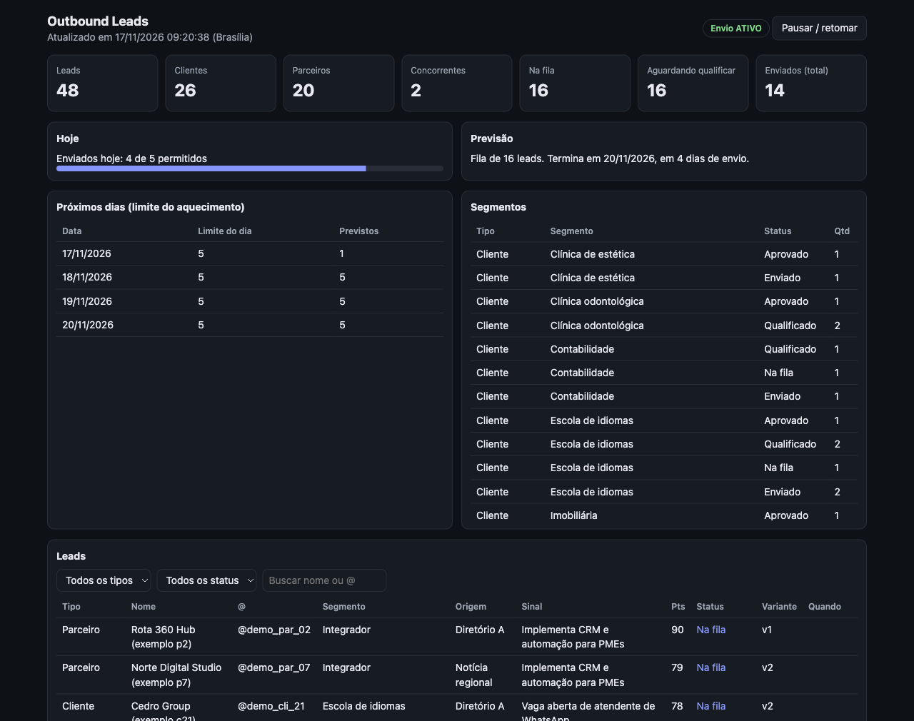
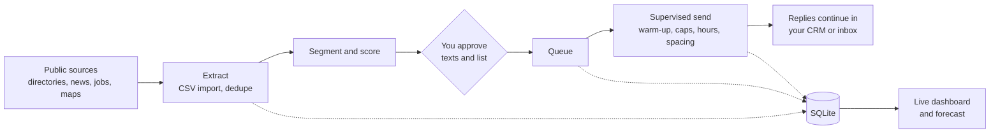

# outbound-leads

**Responsible, human-supervised outbound for the AI-agent era.** Extract and segment leads from public sources, send Instagram DMs gradually with approval, and follow everything on a live local dashboard.

[](https://github.com/erickmourasilva/outbound-leads/actions/workflows/ci.yml)
[](LICENSE)


> 🇧🇷 [Leia em português](README.md)



*The dashboard, running on fictional demo data.*

## Why

Outbound usually fails in one of two ways: spam blasts that burn your account and your reputation, or spreadsheets nobody keeps up to date. `outbound-leads` is the middle path:

- **Extract first, send later.** Build and segment the list before a single message goes out.
- **Gradual by design.** Warm-up schedule, daily caps, business hours, spacing between messages, and an automatic stop at the first platform warning.
- **A human stays in charge.** Nothing is sent without your approval. The browser window is always visible, and you do the login.
- **Built for AI agents.** Install it as a Claude Code plugin (or point any agent at `AGENTS.md`) and just ask. Every command prints JSON.
- **Your data stays yours.** One local SQLite file in `~/.outbound-leads`. No cloud, no telemetry.

## Install

**Claude Code (plugin + skill):**

```
/plugin marketplace add erickmourasilva/outbound-leads
/plugin install outbound-leads@outbound-leads
```

Then ask: *"use outbound-leads to extract partners from my competitors' directories and build the queue."* The skill runs `setup`, installs what is missing and walks you through the rest.

**Other agents (Codex, etc.):** clone the repo and ask the agent to read `AGENTS.md`.

**Manual:**

```bash
git clone https://github.com/erickmourasilva/outbound-leads && cd outbound-leads
./setup.sh                  # installs what is missing (Windows: .\setup.ps1)
python3 -m outbound serve   # dashboard at http://127.0.0.1:8787
```

Try it without touching real data:

```bash
export OUTBOUND_HOME=/tmp/outbound-demo
python3 -m outbound demo && python3 -m outbound serve
```

## How it works



## Principles

1. **Approval first.** No message leaves without explicit authorization.
2. **Gradual.** Start at 5 per day, add 5 per week, hard ceiling of 30 by default.
3. **Visible.** The browser is never headless; credentials are never typed by the tool.
4. **Honest.** No fake typing, no CAPTCHA bypass, no evasion of platform controls.
5. **Stop on warning.** Any block, alert or "try again later" pauses everything.
6. **Respect "no".** The do-not-contact list is permanent.
7. **Public, professional data only.** No personal phone numbers or e-mails, no sensitive traits.

## Commands

Run as `python3 -m outbound <command>`. All output is JSON.

| Command | What it does |
|---|---|
| `setup [--check]` | Installs what is missing (tzdata, agent-browser, Chrome) and lists manual steps |
| `doctor` | Environment status |
| `import file.csv` / `export` | CSV in and out, deduplicated by handle, honours do-not-contact |
| `leads list / add / set-status` | Manage leads |
| `next` | May I send now? Returns the reason, today's cap and the next leads |
| `record-send <@> ok\|failed\|not_accepting\|blocked` | Log a send (`blocked` pauses everything) |
| `pause` / `resume` | Global kill switch. Sending starts **paused** |
| `settings [key value]` | Warm-up, hours and spacing |
| `dnc <@>` | Never contact again |
| `stats` | Counts and forecast |
| `serve` | Live dashboard |
| `demo` | Fill an empty database with fictional leads |

CSV columns: `kind,segment,name,handle,source_kind,source_ref,source_url,signal,signal_date,score,status` (`kind` is `client`, `partner` or `intel`).

## Compatibility

| | Extract and track | Send messages |
|---|---|---|
| Needs | Python 3.10+ (stdlib only; `tzdata` on Windows, installed by `setup`) | Node + npm, the `agent-browser` CLI and its Chrome (`setup` installs them) |
| Platforms | CI on macOS, Linux and Windows (Python 3.10, 3.12, 3.13) | `agent-browser` supports all three; Linux may need `sudo agent-browser install --with-deps` |

Dashboard: `python3 -m outbound serve` comes up on its own at `https://outbound-leads.localhost` when `portless` is installed (`setup` installs it), and falls back to `http://127.0.0.1:8787` otherwise. `python3 -m outbound url` prints the address. The first time, your browser may ask you to trust the certificate: run `portless trust` once.

## Roadmap

- [x] Local store, live dashboard and forecast
- [x] Claude Code plugin, skill, JSON CLI, cross-platform setup and CI
- [x] Send scheduler (pause, hours, caps, spacing, auto-pause on block)
- [ ] Supervised send worker with a daily approval queue
- [ ] A/B report: reply rate per message variant
- [ ] More extraction connectors
- [ ] Dashboard i18n (currently Portuguese)
- [ ] Optional CRM webhooks for reply and opt-out sync

## Responsible use

Automated messaging may violate a platform's terms of service and can get accounts restricted. Keep volume low, use a dedicated account, honour every opt-out and comply with the law where you operate (for example GDPR or Brazil's LGPD). You are responsible for how you use this tool. See [SECURITY.en.md](SECURITY.en.md).

## Contributing

Issues and PRs are welcome. See [CONTRIBUTING.en.md](CONTRIBUTING.en.md).

## License

[MIT](LICENSE)

---

Created by **[Erick Moura](https://github.com/erickmourasilva)**.
