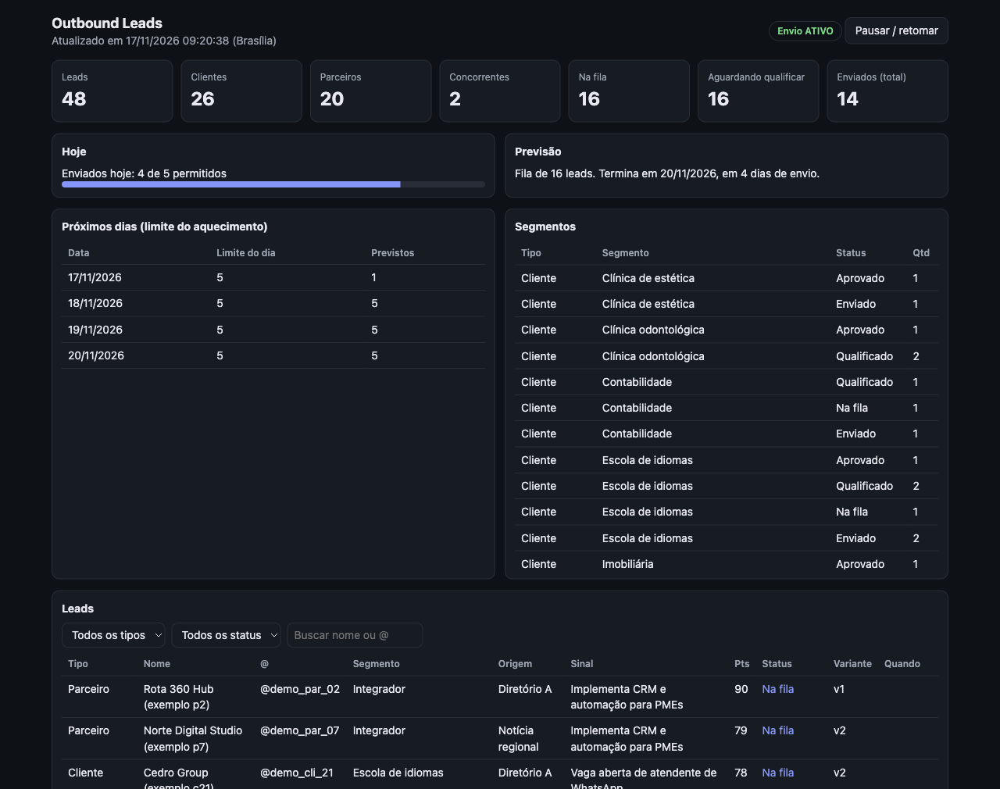
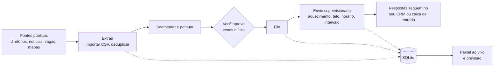

# outbound-leads

**Outbound responsável e supervisionado por humanos, para a era dos agentes de IA.** Extraia e segmente leads de fontes públicas, envie mensagens aos poucos, com aprovação, e acompanhe tudo num painel local ao vivo.

[](https://github.com/erickmourasilva/outbound-leads/actions/workflows/ci.yml)
[](LICENSE)


> 🇬🇧 [Read in English](README.md)



*O painel, rodando com dados fictícios de demonstração.*

## Por quê

O outbound costuma falhar de duas formas: disparos em massa que queimam a conta e a reputação, ou planilhas que ninguém mantém. O `outbound-leads` é o caminho do meio:

- **Extrair primeiro, enviar depois.** A lista é montada e segmentada antes de qualquer mensagem sair.
- **Gradual por construção.** Aquecimento, teto diário, horário comercial, intervalo entre mensagens e parada automática no primeiro alerta da plataforma.
- **Um humano no comando.** Nada é enviado sem a sua aprovação. A janela do navegador é sempre visível, e o login é seu.
- **Feito para agentes de IA.** Instale como plugin do Claude Code (ou aponte qualquer agente para o `AGENTS.md`) e peça. Todo comando imprime JSON.
- **Seus dados são seus.** Um arquivo SQLite local em `~/.outbound-leads`. Sem nuvem, sem telemetria.

## Instalação

**Claude Code (plugin + skill):**

```
/plugin marketplace add erickmourasilva/outbound-leads
/plugin install outbound-leads@outbound-leads
```

Depois peça: *"use o outbound-leads para extrair parceiros dos diretórios dos meus concorrentes e montar a fila."* A skill roda o `setup`, instala o que falta e conduz o resto.

**Outros agentes (Codex etc.):** clone o repositório e peça para o agente ler o `AGENTS.md`.

**Manual:**

```bash
git clone https://github.com/erickmourasilva/outbound-leads && cd outbound-leads
./setup.sh                  # instala o que falta (Windows: .\setup.ps1)
python3 -m outbound serve   # painel em http://127.0.0.1:8787
```

Para testar sem tocar em dados reais:

```bash
export OUTBOUND_HOME=/tmp/outbound-demo
python3 -m outbound demo && python3 -m outbound serve
```

## Como funciona



## Princípios

1. **Aprovação primeiro.** Nenhuma mensagem sai sem autorização explícita.
2. **Gradual.** Começa em 5 por dia, +5 por semana, teto de 30 por padrão.
3. **Visível.** O navegador nunca é headless, e a ferramenta nunca digita credenciais.
4. **Honesto.** Sem digitação falsa, sem burlar CAPTCHA, sem evadir controles da plataforma.
5. **Parar no alerta.** Qualquer bloqueio, aviso ou "tente novamente mais tarde" pausa tudo.
6. **Respeitar o "não".** A lista de não contato é permanente.
7. **Só dados públicos e profissionais.** Sem telefone ou e-mail pessoal, sem traços sensíveis.

## Comandos

Execute como `python3 -m outbound <comando>`. Toda saída é JSON.

| Comando | O que faz |
|---|---|
| `setup [--check]` | Instala o que falta (tzdata, agent-browser, Chrome) e lista os passos manuais |
| `doctor` | Estado do ambiente |
| `import arquivo.csv` / `export` | CSV de entrada e saída, deduplicado por @, respeita não contato |
| `leads list / add / set-status` | Gerenciar leads |
| `next` | Posso enviar agora? Retorna o motivo, o limite do dia e os próximos leads |
| `record-send <@> ok\|failed\|not_accepting\|blocked` | Registra um envio (`blocked` pausa tudo) |
| `pause` / `resume` | Chave geral. O envio começa **pausado** |
| `settings [chave valor]` | Aquecimento, horários e intervalos |
| `dnc <@>` | Nunca mais contatar |
| `stats` | Contagens e previsão |
| `serve` | Painel ao vivo |
| `demo` | Preenche um banco vazio com leads fictícios |

Colunas do CSV: `kind,segment,name,handle,source_kind,source_ref,source_url,signal,signal_date,score,status` (`kind` é `client`, `partner` ou `intel`).

## Compatibilidade

| | Extrair e acompanhar | Enviar mensagens |
|---|---|---|
| Requer | Python 3.10+ (biblioteca padrão; `tzdata` no Windows, instalado pelo `setup`) | Node + npm, o `agent-browser` e o Chrome dele (o `setup` instala) |
| Plataformas | CI em macOS, Linux e Windows (Python 3.10, 3.12, 3.13) | O `agent-browser` cobre os três; no Linux pode exigir `sudo agent-browser install --with-deps` |

Opcional: pnpm e `portless` para uma URL nomeada do painel (`pnpm dev` → `https://outbound-leads.localhost`).

## Roteiro

- [x] Banco local, painel ao vivo e previsão
- [x] Plugin do Claude Code, skill, CLI em JSON, setup multiplataforma e CI
- [x] Agendador de envio (pausa, horário, teto, intervalo, pausa automática em bloqueio)
- [ ] Worker de envio supervisionado, com fila diária de aprovação
- [ ] Relatório A/B: taxa de resposta por variante de mensagem
- [ ] Mais conectores de extração
- [ ] Painel com i18n (hoje em português)
- [ ] Webhooks opcionais de CRM para sincronizar respostas e pedidos de parar

## Uso responsável

Mensagens automatizadas podem violar os termos de uso da plataforma e levar à restrição da conta. Mantenha o volume baixo, use uma conta dedicada, atenda todo pedido para parar e cumpra a lei do seu país (como a LGPD). A responsabilidade pelo uso é de quem usa. Veja [SECURITY.md](SECURITY.md).

## Contribuindo

Issues e PRs são bem-vindos. Veja [CONTRIBUTING.md](CONTRIBUTING.md).

## Licença

[MIT](LICENSE)

---

Criado por **[Erick Moura](https://github.com/erickmourasilva)**.
